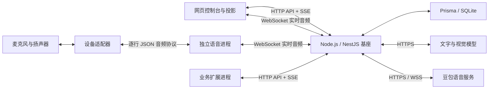

# bySide 基座架构与能力接入说明

本文记录独立重构工程 bySide Foundation 在 2026 年 11 月 15 日的实现，包括网页、投影、模型服务、音频设备和业务扩展的连接方式。

当前仓库已有的 `yatuan-companion/server.mjs` 是原版演示的启动入口。本文中的 `server/`、`original-ui/`、`web/` 和 `sdk/` 等路径均以独立基座工程的根目录为基准。基座采用 Node.js、TypeScript、NestJS、Prisma 和 SQLite。

## 1. 整体架构

系统由一个常驻基座进程、浏览器页面、可单独启动的音频设备进程，以及按需运行的业务扩展组成。



| 组成部分 | 职责 | 启动方式 |
|---|---|---|
| 基座进程 | 伙伴状态、聊天、记忆、成长、模型调用、事件同步、扩展路由 | `npm start` |
| 网页控制台与投影 | 界面渲染、用户操作、浏览器设备采集与播放 | 浏览器打开基座地址 |
| 独立语音进程 | 连接音频适配器、重组音频帧、控制播放和实时会话 | `npm run voice:native` |
| 音频设备适配器 | 打开实际设备、采集 PCM、播放 PCM、报告播放完成 | 由独立语音进程启动 |
| 业务扩展 | 饮食、棋类等独立业务及其数据 | 扩展自行启动 HTTP 服务 |

关闭网页后，基座进程继续运行。使用独立语音时，基座和音频设备进程持续运行即可继续对话。摄像头观察、AR 预览和网页投影的运行依赖对应页面。

## 2. 运行入口与通信约定

独立基座需要 Node.js 22.12 或更高版本。完成依赖安装、环境配置和数据库初始化后运行构建与启动命令。

```sh
npm install
npm run db:setup
npm run build
npm start
```

模型与语音配置保存在基座根目录的 `.env`。首次使用可从 `.env.example` 创建配置文件，再填写对应服务的地址、模型和密钥。

| 入口 | 默认地址 |
|---|---|
| 主要陪伴界面 | `http://127.0.0.1:4173/` |
| React 基础界面 | `http://127.0.0.1:4173/foundation` |
| 投影页面 | `http://127.0.0.1:4173/projection.html` |
| HTTP API | `http://127.0.0.1:4173/api/v1` |
| OpenAPI 文档 | `http://127.0.0.1:4173/api/docs` |
| 实时语音 WebSocket | `ws://127.0.0.1:4173/api/v1/speech/realtime` |

HTTP 请求与普通响应采用 JSON，日期使用 ISO 8601 格式。SSE 用于服务端向客户端推送事件，WebSocket 用于双向传输实时音频与控制消息。默认伙伴会话为 `default`，不同角色外观共享该伙伴的聊天、记忆和成长。

当前服务默认监听本机回环地址，并检查请求的 Host 和浏览器 Origin。独立部署的网页需要通过同源代理连接基座。跨机器设备可以通过本机适配器充当网关，设备与网关之间的认证及加密由适配器实现。

## 3. 网页和投影接入

基座通过静态文件服务提供 `original-ui/` 和构建后的 `web/dist/`。网页中的 JavaScript 在浏览器执行，通过 HTTP 操作后端数据，并订阅 SSE 获取更新。

| 操作 | 接口 |
|---|---|
| 获取伙伴、最近消息和记忆 | `GET /api/v1/snapshot` |
| 订阅状态变化 | `GET /api/v1/events?after=<id>` |
| 发送文字聊天 | `POST /api/v1/chat` |
| 取消文字请求 | `POST /api/v1/chat/{requestId}/cancel` |
| 修改角色、性格和投影设置 | `PATCH /api/v1/companion` |
| 上传角色图片 | `POST /api/v1/characters/image` |
| 根据参考图生成角色预览 | `POST /api/v1/characters/generate` |
| 查询、增加记忆 | `GET /api/v1/memories`、`POST /api/v1/memories` |
| 修改、删除记忆 | `PATCH /api/v1/memories/{id}`、`DELETE /api/v1/memories/{id}` |
| 获取陪伴会话的投影状态 | `GET /api/v1/sessions/default/projection` |

文字聊天由调用方提供稳定的 `requestId`。同一 ID 和同一内容在成功后重试会返回已有结果。取消请求后，已经保存的用户消息会保留。

```json
{
  "text": "今天想聊一聊茶",
  "requestId": "chat-20261115-001"
}
```

角色或消息发生变化后，基座发布 `companion.updated`、`message.created`、`memory.changed` 等事件。主要界面的 `original-ui/state.js` 收到事件后重新获取快照，控制台与投影读取同一份伙伴状态。同一浏览器内还使用 BroadcastChannel 同步临时展示。

独立音频设备的字幕和播放动作通过 `voice.presentation` SSE 事件同步到主要界面与投影。设备客户端根据实际播放进度上报 `presentation.update`。新打开的页面会收到当前临时状态，设备关闭或连接断开后该状态被清除。此类事件复用已持久化的 SSE 游标，临时字幕保存在进程内存中。

React 基础界面目前订阅伙伴、消息和记忆更新。独立音频的临时字幕展示接入位于 `original-ui/`。

## 4. 实时语音与音频设备接入

### 4.1 浏览器与独立设备两种入口

| 运行方式 | 音频采集与播放 | 基座连接 |
|---|---|---|
| 浏览器实时语音 | `getUserMedia` 采集，Web Audio 播放 | `/api/v1/speech/realtime` |
| 独立语音进程 | 外部音频适配器负责输入和输出 | `/api/v1/speech/realtime` |

默认适配器使用 macOS 的系统输入与输出设备。它通过 Swift 和 AVFoundation 实现硬件访问，TypeScript 进程负责基座通信和会话控制。默认半双工，在模型输出音频及设备实际播完后的短暂时间内发送静音，以降低外放回声。

```sh
npm run voice:native
```

戴耳机时可以通过 `--full-duplex` 开启打断，通过 `--show-transcript` 在终端显示转写与回复。按 `Ctrl+C` 停止采集、播放和云端会话。基座当前允许一个实时语音连接，浏览器实时语音与独立设备进程共享这一名额。

### 4.2 基座实时 WebSocket 协议

客户端连接后发送启动命令。独立设备客户端通过 `presentation` 字段启用后端展示同步。

```json
{"type":"session.start","fullDuplex":false,"presentation":"device"}
```

收到 `session.ready` 后开始发送二进制音频。输入采用 16 kHz、单声道、PCM s16le，每帧 20 ms、640 字节，并按实际时间发送。基座返回的二进制音频采用 24 kHz、单声道、PCM s16le，由客户端排队播放。

| JSON 消息 | 含义 |
|---|---|
| `session.ready`、`session.closed` | 会话就绪与结束 |
| `transcript.partial`、`transcript.final` | 用户临时转写与完整转写 |
| `assistant.text.delta`、`assistant.text.done` | 模型文字片段与完整回复 |
| `audio.started`、`audio.done` | 上游音频生成开始与结束 |
| `audio.flush` | 停止并清空待播放音频 |
| `response.cancel` | 客户端请求打断 |
| `presentation.update` | 独立设备上报临时字幕与播放动作 |
| `session.close` | 客户端请求结束会话 |
| `error` | 会话或供应商错误 |

`audio.done` 表示上游生成结束。客户端依据自己的播放完成回调判断扬声器何时播完，并据此更新展示和恢复半双工收音。

基座使用服务端密钥连接豆包端到端实时语音。创建会话时读取伙伴性格、已保存记忆和最近完整对话。豆包直接返回语音和文字，基座保存确认完成的用户转写及完整回复，再更新记忆、成长与伙伴状态。

### 4.3 跨平台音频适配器协议 1.0

其他设备可使用 Python、Rust、C++、Node.js 或厂商 SDK 实现适配器。适配器可以分别选择麦克风和扬声器，也可以连接 USB、蓝牙或网络硬件。

```sh
npm run voice:native -- --audio-adapter /absolute/path/to/audio-adapter
```

设备适配器与 TypeScript 进程使用标准输入和标准输出交换 UTF-8 JSON，每行一个对象。适配器打开设备后报告版本和音频格式。

```json
{"type":"ready","protocolVersion":"1.0","input":{"encoding":"pcm_s16le","rate":16000,"channels":1},"output":{"encoding":"pcm_s16le","rate":24000,"channels":1}}
```

| 方向 | 消息 | 实现要求 |
|---|---|---|
| 适配器 → 语音进程 | `capture`，携带 `audio` | 将采集的 PCM 字节编码为 Base64 |
| 语音进程 → 适配器 | `play`，携带 `id` 和 `audio` | 按顺序播放输出 PCM |
| 适配器 → 语音进程 | `played`，携带对应 `id` | 在该段音频实际播放完后发送 |
| 语音进程 → 适配器 | `flush` | 立即停止并清空待播放音频 |
| 语音进程 → 适配器 | `stop` | 释放输入与输出设备并退出 |
| 适配器 → 语音进程 | `error`，携带 `message` | 报告权限拒绝、设备断开等故障 |

音频格式固定为输入 16 kHz、输出 24 kHz、单声道、16 位小端 PCM。适配器的标准输出用于协议传输。TypeScript 定义位于 `sdk/audio-device.ts`，静音模拟器位于 `examples/audio-device-simulator.cjs`。

### 4.4 分段识别与朗读

基座另提供流式识别和独立语音合成入口。

| 接口 | 用途 |
|---|---|
| WebSocket `/api/v1/speech/asr/stream` | 音频转文字，返回临时与完整识别结果 |
| HTTP `POST /api/v1/speech` | 文字转音频，返回 `mime` 与 Base64 `audio` |

网页可以将识别后的文字提交给 `/chat`，再将文字回复交给语音合成或系统语音播放。实时语音、流式识别和单独合成的资源授权及配置分别检查。

## 5. 摄像头与视觉接入

浏览器通过设备 API 选择摄像头并采集画面。需要模型观察时，客户端将图片 data URL 提交到 `POST /api/v1/vision`，可以附带 `prompt` 和 `requestId`。基座验证图片格式后调用配置的模型，并发布 `vision.observed` 事件。模型配置需要具备图片输入能力。

```json
{
  "image": "data:image/jpeg;base64,...",
  "prompt": "请简短描述桌面上的物品",
  "requestId": "vision-20261115-001"
}
```

客户端通过 `POST /api/v1/vision/{requestId}/cancel` 取消对应请求。当前主要界面负责观察定时和采样节奏，结束陪伴时停止设备与请求。

桌面 AR 预览在浏览器处理视频和几何跟踪。普通图片问答使用上述 HTTP 接口。

“开始陪伴”将麦克风与桌面观察合并到 `/api/v1/speech/realtime` 会话。客户端在 `session.start` 中启用 `desktopVision`，通过 `vision.frame` 上传图片，接收 `vision.capture` 后提供带原 `captureId` 的新画面。基座分析图片并通过内置 `observe_desktop` 工具返回同一豆包会话，音频保持传输。AR 摄像头通过同源窗口的采样通道共享画面。暂停观察会取消分析并清除图片缓存，语音继续连接。完整消息格式见 [实时语音接入](实时语音接入.md)。

## 6. 业务扩展接入

业务扩展独立运行 HTTP 服务，可以使用自己的语言、框架和数据库。基座通过注册清单发现扩展，通过 HTTP 调用动作，通过 SSE 向扩展发送状态变化。

### 6.1 提供动作并注册清单

扩展先提供 `POST /actions/{action}`。本机主控随后调用 `POST /api/v1/extensions` 注册清单。

```json
{
  "protocolVersion": "1.0",
  "id": "meal-helper",
  "name": "饮食陪伴",
  "url": "http://127.0.0.1:4185",
  "permissions": ["read", "growth", "respond"],
  "actions": ["analyze-meal"],
  "events": ["message.created", "companion.updated"]
}
```

基座返回扩展 ID 和一次性显示的 `token`。扩展将令牌保存在自己的私有配置中，调用扩展专用接口时使用 `Authorization: Bearer <token>`。当前清单地址要求本机 HTTP 服务。

### 6.2 调用动作与回传结果

网页或主控调用 `POST /api/v1/extensions/meal-helper/actions/analyze-meal`，基座将 JSON 请求转发到扩展的 `/actions/analyze-meal` 并返回其 JSON 结果。当前动作请求超时为 5 秒，业务参数校验与重复调用处理由扩展负责。

扩展可按权限访问下列接口。

| 权限 | 接口 | 用途 |
|---|---|---|
| `read` | `GET /api/v1/extensions/{id}/snapshot` | 读取伙伴、聊天和记忆 |
| `read` | `GET /api/v1/extensions/{id}/stream` | 接收清单声明的 SSE 事件 |
| `growth` | `POST /api/v1/extensions/{id}/events` | 提交活动，由基座计算成长 |
| `respond` | `POST /api/v1/extensions/{id}/respond` | 更新伙伴当前显示的回应 |

成长活动使用稳定的 `eventId` 去重。同一扩展提交相同 ID 时返回 `duplicate: true`。当前每个新扩展活动增加 1 点成长，成长上限为 100。

```json
{"eventId":"meal-20261115-dinner","kind":"meal.completed"}
```

扩展成功处理 SSE 事件后保存游标，在重连时通过 `after` 或 `Last-Event-ID` 续传，并容忍重复事件。恢复后可读取快照校准状态。TypeScript 客户端位于 `sdk/client.ts`，包括主控用的 `BySideClient` 和扩展用的 `BySideExtensionClient`。

### 6.3 与语音工具调用组合

实时语音会话支持在 `session.start` 中声明工具，通过 `tool.call` 接收请求，再通过 `tool.result` 返回结果。主控程序负责选择工具、校验参数、调用对应扩展并回传结果。目前默认独立音频客户端负责实时对话、设备输入输出和展示同步，扩展工具编排需要调用方实现。

## 7. 设备登记与当前接入边界

`POST /api/v1/devices` 可以登记设备及 `camera`、`microphone`、`speaker`、`projection` 能力。`POST /api/v1/devices/{id}/lease` 获取 30 秒的能力租约，释放使用 `DELETE /api/v1/devices/{id}/lease/{capability}`。租约保存在基座进程内存中。

当前实现的接入状态如下。

| 能力 | 当前状态 |
|---|---|
| 网页聊天、记忆、角色和成长 | 通过 HTTP API 与基座数据同步 |
| 主要界面与投影 | 通过快照、SSE 和本地展示通道同步 |
| 豆包实时语音 | 浏览器与独立设备进程均接入同一 WebSocket |
| 音频设备适配器 | 已提供 macOS 实现和平台无关协议，其他平台硬件需要实现并验收对应适配器 |
| 设备登记与租约 | 已有接口，独立音频进程目前使用实时会话的单连接限制协调占用，租约整合尚待完成 |
| 文字与视觉供应商 | 使用基座配置的 Chat Completions 兼容接口 |
| 饮食和五子棋 | 现有界面仍使用前端本地逻辑，后续可迁入业务扩展 |
| 远端设备 | 可由本机适配器连接，直接网络接入需要补充认证与网络设备接口 |
| 扩展权限 | 已有专用接口令牌检查，主控接口采用本机单用户信任模型 |

伙伴状态、消息、记忆、成长事件、扩展注册和设备信息通过 SQLite 持久化。临时字幕、播放进度和设备租约保存在运行进程中。服务端从 `.env` 读取模型与语音密钥，客户端通过基座调用供应商。

## 8. 代码定位

以下路径以独立基座工程根目录为基准。

| 路径 | 内容 |
|---|---|
| `server/src/main.ts` | 服务启动、静态页面、HTTP API、OpenAPI 与 WebSocket 挂载 |
| `server/src/modules.ts` | 伙伴、聊天、记忆、视觉、扩展、设备及 SSE 处理 |
| `server/src/realtime.ts` | 豆包实时语音连接、会话、转写和回复保存 |
| `server/src/speech.ts` | 流式识别及语音 WebSocket 路由 |
| `server/src/native-voice.ts` | 独立音频会话、采集节奏、播放控制与展示状态 |
| `server/src/native-audio.ts` | 音频适配器子进程与逐行 JSON 协议 |
| `server/src/native-voice-cli.ts` | 独立语音的命令行入口 |
| `native-voice/AudioBridge.swift` | macOS 音频设备实现 |
| `original-ui/state.js` | 主要网页的快照、持久状态与 SSE 接入 |
| `original-ui/realtime-voice.js` | 浏览器实时语音采集与播放 |
| `sdk/client.ts` | HTTP、扩展与实时语音的常用 TypeScript 调用 |
| `sdk/audio-device.ts` | 平台无关音频适配器协议类型 |
